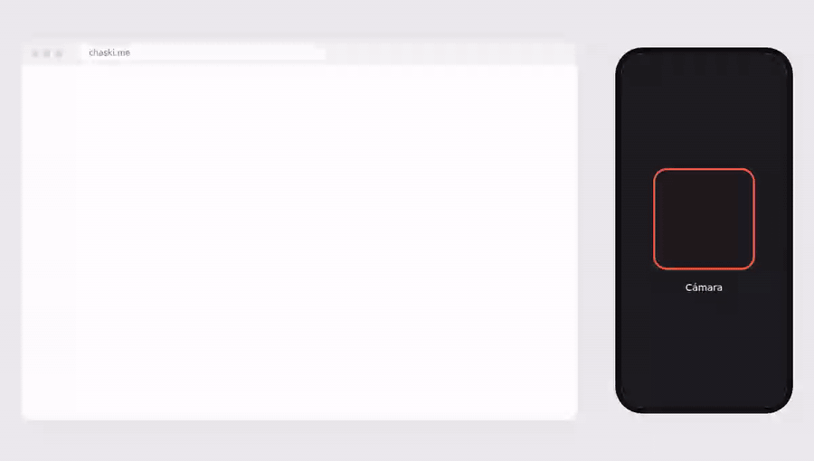
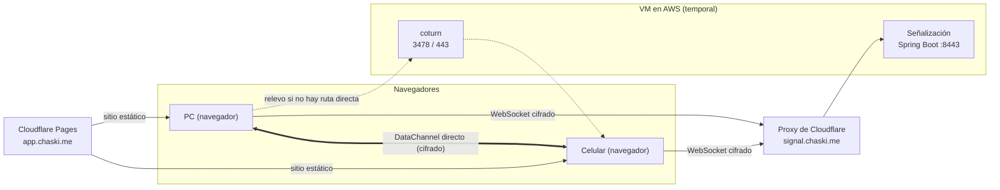

# Chaski

[](https://github.com/1juandaniel0/chasqui/actions/workflows/web.yml)
[](https://github.com/1juandaniel0/chasqui/actions/workflows/signal.yml)
[](https://github.com/1juandaniel0/chasqui/actions/workflows/security.yml)
[](LICENSE)

Pasa archivos y texto entre dos dispositivos escaneando un QR. Sin cuentas, sin instalar nada en la PC y sin que nada se guarde en un servidor.

**Demo:** https://chaski.me



## Qué es

Abres Chaski en una PC (por ejemplo la del trabajo, la universidad o una cabina), escaneas el QR con tu celular y ya puedes mandar archivos o texto en ambos sentidos. Los datos viajan directo de un navegador a otro con WebRTC, cifrados de extremo a extremo. El servidor solo ayuda a que los dos dispositivos se encuentren y no puede leer lo que pasa.

Pensado para mover algo a una PC ajena o poco confiable sin iniciar sesión de WhatsApp o correo en ella.

### El nombre

Los **chasquis** eran los mensajeros del Imperio Inca: corrían por el Qhapaq Ñan en relevos y llevaban mensajes de un punto a otro. Aquí pasa igual: el mensaje va de un dispositivo a otro y nadie se queda con él.

**Todo lo que hace y en qué se diferencia de WhatsApp Web, Drive, PairDrop o LocalSend:** [docs/caracteristicas.md](docs/caracteristicas.md).

## Cómo se usa

1. En la PC abres [chaski.me](https://chaski.me). El QR aparece al instante.
2. Escaneas el QR con la cámara del celular y se abre la web.
3. Ambos se conectan solos y muestran "Conectado".
4. En el celular eliges archivos o escribes texto (también funciona al revés).
5. En la PC aparece cada envío con su progreso y un botón para descargar o copiar. Al cerrar la pestaña, la sala desaparece.

## Cómo protege tus archivos

- **Nada se almacena.** Los archivos van en vivo de un navegador a otro. Si uno se desconecta, no queda copia en ningún servidor.
- **El secreto vive en el QR.** El QR contiene la URL con un secreto aleatorio de 128 bits después del `#`. Esa parte nunca se envía al servidor.
- **La señalización va cifrada.** De ese secreto se derivan (HKDF-SHA256) un `roomId` y una clave AES-GCM. Las ofertas WebRTC viajan cifradas, así que un servidor comprometido no puede hacer un ataque de intermediario sin que se note.
- **El canal de datos va cifrado con DTLS.** Incluso cuando el tráfico pasa por el relevo TURN.
- **Salas de 2 dispositivos**, que expiran solas, con opción de expulsar a quien no debería estar.
- **Sin scripts de terceros, sin cookies, sin analítica**, y con una CSP estricta.
- **Código abierto** (AGPL-3.0): puedes revisarlo.

Lo que Chaski no puede hacer: proteger una PC de destino comprometida o con monitoreo. El cifrado protege el trayecto, no la PC. Más detalle en [docs/threat-model.md](docs/threat-model.md).

## Arquitectura



La línea gruesa es el camino normal de los datos. Las punteadas solo se usan cuando no hay ruta directa, y aun así el contenido va cifrado. Más en [docs/architecture.md](docs/architecture.md).

## Stack

| Pieza | Tecnología |
|-------|------------|
| Cliente | React + TypeScript + Vite (PWA), pnpm |
| Transporte | WebRTC (`RTCDataChannel`) |
| Señalización | Spring Boot 3, Java 21, WebSocket, Maven |
| Relevo | coturn (TURN REST API, credenciales temporales) |
| Hosting | Cloudflare Pages + VM en AWS, temporal mientras dure el crédito (Docker Compose). Destino a largo plazo: Oracle Cloud Always Free ([ADR 0005](docs/adr/0005-oracle-cloudflare-hosting.md)) |
| CI/CD | GitHub Actions, GHCR, Dependabot, CodeQL |

## Desarrollo local

Requisitos: Docker, Node 22 con pnpm y (opcional) JDK 21 + Maven.

```bash
# 1. Señalización + coturn (sin TLS, secretos de desarrollo)
docker compose -f infra/docker-compose.dev.yml up

# 2. Frontend
pnpm install
pnpm --dir apps/web dev
```

Abre `http://localhost:5173` en dos pestañas y ya puedes transferir.

**Probar desde el celular:** `crypto.subtle` y la cámara solo funcionan en contextos seguros (HTTPS o `localhost`). Desde el celular a la IP de tu PC por HTTP fallan. Opciones:

- Túnel de Cloudflare: `cloudflared tunnel --url http://localhost:5173`
- Certificados locales con [mkcert](https://github.com/FiloSottile/mkcert)

Si usas un túnel, agrega su origen a `ALLOWED_ORIGINS` de la señalización.

## Estructura del repositorio

```
chasqui/
├── apps/
│   ├── web/        # Cliente React + TypeScript + Vite
│   └── signal/     # Servidor de señalización (Spring Boot)
├── infra/          # Docker Compose, coturn, scripts de despliegue
├── docs/
│   ├── protocol.md       # Contrato cliente <-> servidor
│   ├── architecture.md
│   ├── threat-model.md
│   ├── primeros-pasos.md # Checklist de configuración inicial
│   └── adr/              # Decisiones de arquitectura
├── .github/        # Workflows de CI, Dependabot, plantilla de PR
├── SECURITY.md
└── LICENSE
```

## Hoja de ruta

| Fase | Requisitos |
|------|------------|
| **MVP** | RF1 emparejar por QR, RF2 archivos en ambos sentidos (varios, con progreso y cancelación), RF3 texto con copiado en un toque |
| **Fase 2** | RF5 menú Compartir de Android (share target) ✅, RF4 reconexión automática, escritura directa a disco (streaming) |
| **Fase 3** | RF6 emparejar con código corto (PAKE), RF7 modo mostrador (QR fijo para un negocio que solo recibe) |

**Ideas en evaluación** (se deciden según lo que pidan los usuarios):

- **Dispositivos de confianza:** emparejar tu propia laptop una vez y reconectar sin QR (como KDE Connect o LocalSend). Se hará si muchos usuarios piden reconectar sus propios dispositivos.
- **Cuentas con historial: descartado por ahora.** Choca con el caso de uso (la PC ajena, donde no se debe iniciar sesión) y con la promesa "nada se guarda", además de sumar costos de almacenamiento, riesgo de abuso y obligaciones de la Ley 29733.
- **App en la Play Store:** primero como TWA (la misma PWA empaquetada); app nativa solo si hacen falta transferencias en segundo plano.

## Contribuir y seguridad

Usa ramas por funcionalidad, PRs y Conventional Commits. Para reportar vulnerabilidades mira [SECURITY.md](SECURITY.md).

## Licencia

[GNU AGPL-3.0](LICENSE). Si publicas una versión modificada del servicio, debes publicar su código.
