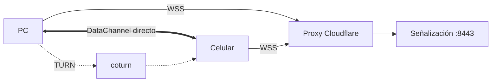
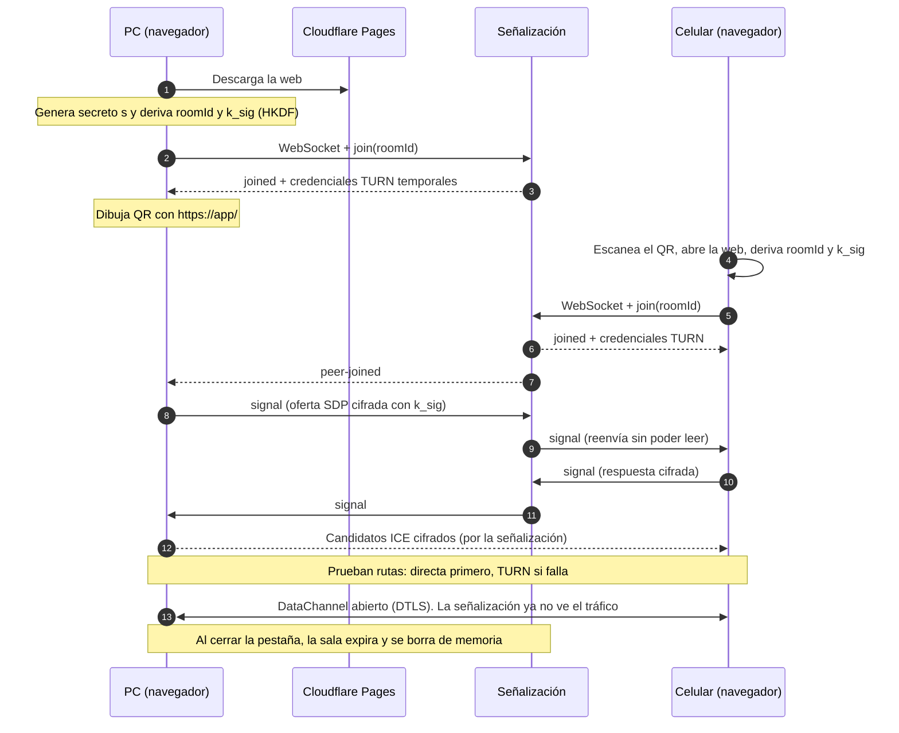

# Arquitectura

Cuatro piezas: la web estática, la señalización, el relevo TURN y los dos navegadores. Los archivos viajan directo entre navegadores; los servidores solo ayudan a que se encuentren.

## Componentes

| Componente | Dónde corre | Qué hace |
|------------|-------------|----------|
| Web (PWA) | Cloudflare Pages | Sirve el cliente estático, genera el secreto y el QR, cifra y transfiere |
| Señalización | VM Oracle, contenedor Spring Boot | Enruta mensajes cifrados entre los dos dispositivos de una sala y entrega credenciales TURN |
| coturn | La misma VM, red del host | Relevo de tráfico cuando no hay ruta directa (también STUN) |
| Navegadores | PC y celular | Establecen el `RTCDataChannel` cifrado con DTLS |

## Secuencia de conexión

El detalle de mensajes, formatos y límites está en [protocol.md](protocol.md).

## Subdominios y puertos

| Subdominio | Apunta a | Puertos | Por qué así |
|------------|----------|---------|-------------|
| `app.chasqui.example` | Cloudflare Pages | 443 | Sitio estático en CDN |
| `signal.chasqui.example` | Proxy de Cloudflare, luego VM:8443 | 443 hacia el usuario, 8443 en el origen | Cloudflare absorbe ataques y soporta WebSocket; 8443 deja libre el 443 de la VM |
| `turn.chasqui.example` | Directo a la IP de la VM (sin proxy) | 3478 UDP/TCP, 443 TCP (TLS), UDP 49160-49360 | El proxy de Cloudflare no transporta UDP ni TURN |

Además, la VM expone el puerto de gestión de Spring Actuator (9090) solo en `127.0.0.1`.

## Estado del servidor

Las salas viven en memoria (`ConcurrentHashMap`) en una sola instancia. Si el servidor se reinicia, las salas se pierden y los clientes deben volver a unirse (RF4 en Fase 2 lo automatiza). Escalar a varias instancias requeriría Redis pub/sub o enrutar por `roomId`; el MVP no lo necesita.

## Despliegue

| Pieza | Cómo se despliega |
|-------|-------------------|
| Web | Push a `main`, Cloudflare Pages construye y publica (vista previa por PR) |
| Señalización | GitHub Actions construye la imagen arm64, la sube a GHCR y la VM la descarga con `infra/scripts/deploy.sh` |
| coturn | Configuración versionada en `infra/coturn/` |
| TLS | Cloudflare (web y señalización); certificado de origen de Cloudflare en 8443; Let's Encrypt para TURN |

Rollback de la señalización: volver a desplegar con la etiqueta (`SIGNAL_TAG`) del commit anterior.
